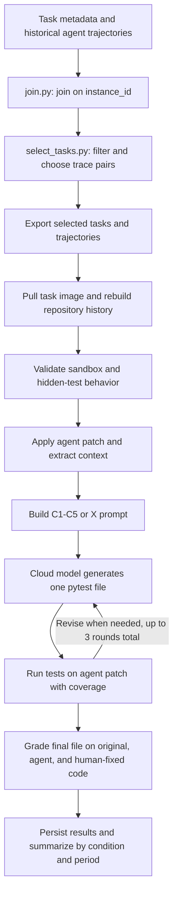

# Trace-conditioned test generation: codebase review

Reviewed on October 31, 2026. This document describes the implementation and observed artifacts; it does not certify every task image or API deployment. No experiment was launched and no implementation was changed during the review.

The study asks whether a coding agent's work log helps a separate model write tests that detect defects in that agent's patch. The coding agent has already run: its trajectory and patch come from a dataset. The experiment generates tests, executes them in repository containers, and compares their behavior on the original code, agent patch, and human fix. It does not train a model or rerun the original coding agent.

**Two implementations must be distinguished.** The local checkout is based on commit `d0e7b91` with existing uncommitted changes for the 30-task Sol/high experiment. Amogh's reviewed branch is `claude/project-thread-3w5urv`, pinned to `44ec6b20afeb790a8c5c625497c89bf0f163967d`. Its full-study results were committed at `4a7a1cae065f57d1c116abda78c4e329b2137519`. Neither implementation is a simple superset of the other. The remote files were read in a temporary directory, preserving the working tree.

[Pinned upstream branch](https://github.com/amoghshetty7436/trace-conditioned-testgen/tree/44ec6b20afeb790a8c5c625497c89bf0f163967d)

**The files divide into the following responsibilities.**

| File | Responsibility and useful entry points |
|---|---|
| `src/join.py` | Loads both SWE-rebench task splits, deduplicates task IDs, joins trajectories, assigns historical date periods, and writes light/full Parquet plus a sanity report. |
| `src/select_tasks.py` | Eligibility filters, heuristic trajectory leak checks, resolved/unresolved pairing, task sampling, pilot selection, and export of selected metadata/full trajectories. |
| `src/pilot.py` | Shared container and patch helpers, environment repair, hidden-test execution and verdict parsing, pilot export, and original-image validation. Amogh's version also exports the full study and supports Podman. |
| `src/sandbox.py` | Coverage-wheel download, repository history reconstruction, leak checks, clean-image creation, and an export/import fallback when image commit fails. |
| `src/traces.py` | Raw and structured trace rendering, summarization prompt, clipping, and deterministic selection of the mismatched trace donor. Identical across the reviewed implementations. |
| `src/llm.py` | Streaming Chat Completions requests, environment-based endpoint/model configuration, token accounting, pacing, and retries. Substantial differences between implementations. |
| `src/tester.py` | Prompt construction, context extraction, generation/revision, coverage, three-way grading, orchestration, resume, and summary output. |
| `src/prepare_new.py` | Local-only exporter for a newer-task subset. Reuses the newer pilot records and fetches additional selected trajectories with Parquet HTTP range reads. |
| `scripts/compare_runs.py` | Local-only report for the 30-task experiment and matched pilot comparisons. Contains assumptions specific to that experiment. |
| `tests/test_experiment.py` | Nine local unit tests for API payloads, grading errors, configuration checks, reply caching, resume, container concurrency, and summary sharing. |
| `perlmutter/setup.sh` | Upstream setup for the earlier local-model gate: separate harness/vLLM environments and model weights. It is unnecessary to download those weights for a cloud-only Terra run. |
| `perlmutter/gate.sbatch` | Earlier eight-task gpt-oss-120b gate; serves the model across four GPUs and runs eight tester shards. |
| `perlmutter/compare.py` | Checks whether the gate model catches a hand-selected set of seven harder and two easier patch-level bugs. This is a selection gate, not the full-study statistical analysis. |
| `perlmutter/terra.sbatch` | Full-study CPU-node launcher: Azure model, 32 shards by default, validation, output tag, and seed-range controls. |
| `.entire`, `.claude`, `.codex`, `.cursor` configuration | Entire session/checkpoint integration. These hooks are not part of experiment execution or grading. |

**Data selection and the unit of measurement.** The saved join report has 67,074 trajectories, 21,336 deduplicated task records, and 6,306 tasks represented by trajectories. All trajectory rows found a matching task. The README's task-row count describes a different counting stage; use the report for deduplicated counts.

Eligibility requires an old/new-period task, an image, nonempty FAIL_TO_PASS tests, a human patch touching one to three files, a nonempty agent patch editing at most three existing files, and a trajectory of at most 400,000 characters. Newly created agent files are excluded from the three-existing-file limit. Successful submissions and maximum-iteration exits qualify; crashes do not.

The trajectory leak filter looks for future-dated git output after commands that reach beyond HEAD, or assistant commands fetching the same upstream GitHub repository. It drops the affected trajectory, not automatically the whole task. This differs from wording still present in the README. It is a heuristic, not proof that a trajectory contains no leaked information.

For each task, selection chooses one dataset-resolved and one dataset-unresolved trajectory, preferring traces without recorded git-history use and randomizing with a fixed selection seed. Every eligible newer task is retained; 75 older tasks are sampled, with the filtered split preferred. The saved selection is 94 newer plus 75 older tasks, or 338 trajectories. The pilot contains 20 tasks, split evenly across periods.

One case is `(trajectory_id, condition, generation seed)`. One task therefore supplies 12 cases per seed and the intended full study supplies 2,028. A generation seed differs from the seed used to select tasks. Multiple generated tests within a case are not independent task samples.

The historical date windows are old before June 1, 2024, and new from September 1, 2024 through the end of April 2025. They originated in an earlier tester-model design. They do not establish training-data exclusion for Terra or Sol. The date implementation also includes exactly midnight May 1 because the upper comparison is inclusive.

**Three export paths exist.** `pilot.py export` requires the ignored `selected_traces.parquet` and exports only pilot rows. Local `prepare_new.py` uses the committed selected CSV and exports a newer-task subset into a separate directory under the pilot filenames; it cannot export all 169 mixed-period tasks. Upstream `pilot.py export-study` rebuilds every selected pair from Hugging Face and writes `study_tasks.jsonl` and `study_traces.jsonl.gz` without requiring the selected Parquet file.

The study export uses current dataset revisions without recording them. The local subset exporter records revisions and uses revision-specific URLs for fresh downloads, but reuses old cached files and pilot records without verifying their revisions. Rerunning an exporter after the upstream datasets change can therefore produce mixed provenance. Preserve the original export bytes, record their hashes, and pin dataset revisions for a reproducible new run. Image tags are also not pinned to immutable digests by the current experiment code.

**Sandbox preparation and execution.** Each task image is expected to contain the base repository at `/testbed`. Cleaning records the tracked paths, removes `/testbed/.git`, and creates one new commit from the existing working-tree files. It assumes the image already represents the correct base; it does not explicitly check out the exported `base_commit`. Untracked working-tree files are not comprehensively removed.

Coverage is installed offline inside the image using host-downloaded wheels for Python 3.6–3.13. Missing coverage does not necessarily prevent generation or grading. The wheel cache considers any coverage wheel sufficient to skip all further downloads, so an interrupted first download can leave incomplete Python-version coverage.

The checker looks for one commit, one ref, and no other `.git` directory. Its leak scan uses added lines from the human fix and hidden tests, at least 30 characters long with sufficient alphanumeric content. Lines already found in the base repository are discounted. A file is suspicious when it matches the configured fraction/count threshold, normally at least 30% and two lines, with a one-line exception when only one candidate exists. This is more nuanced than the README's claim that no file may contain any added line.

The checker parses marker lines from shell output. Missing leak markers default to empty strings, so the leak scan does not fully fail closed when its inner scanning code fails. The container return status is not checked by `check()`. This is a code-level weakness, not evidence that a saved leak result was wrong.

Test containers are disposable and have networking disabled. The shared shell prelude activates the repository environment, repairs editable-install paths, handles installed packages shadowing `/testbed`, and applies patches with `git apply --recount` plus a fuzz-tolerant fallback. Host API requests still use the network. Hidden human tests are used in separate validation containers, not deliberately supplied to the test-generation prompt.

**What each condition actually sees.**

| Condition | Prompt information |
|---|---|
| C1 | Issue, agent diff, and contents of changed existing Python files after applying the agent patch. |
| C2 | C1 plus related existing test files and the README. |
| C3 | C2 plus an LLM-generated trace summary. |
| C4 | C2 plus a structured sequence of actions, short tool results, failure indicators, and uncertainty words. |
| C5 | C2 plus the clipped raw trace. |
| X | C2 plus the clipped raw trace from a different task with the closest measured trajectory length. It uses the same heading as C5. |

C3, C4, C5, and X independently extend C2; they are not cumulative. New Python modules are visible through the diff but excluded from full-file context and the covered-file set. Related tests are selected heuristically by filename/import matches, up to two matches per changed file. The generated test is placed near the first selected test, otherwise in `tests/` or the repository root. This choice can select an integration-test directory with unsuitable fixtures or dependencies.

Full-mode section limits are characters, not tokens: issue 10k, diff 30k, files 60k, related tests 30k, README 4k, trace 60k, feedback 6k, and summary input 60k. C5 is not literally an unmodified full trajectory: tool outputs are clipped to 1,500 characters, then the whole rendering retains the first quarter and last three quarters of its budget. The original system prompt and initial task message are omitted. C4 connects tool results by order rather than matching tool-call IDs.

C3 summaries are cached by trajectory ID and requested model name and reused across conditions/seeds. Cache keys do not include reasoning effort, the summary prompt, or input budget. X's donor is deterministic within the loaded trace pool, but expanding that pool can change the donor. The local runner records the donor ID; Amogh's runner does not.

**Generation, feedback, and grading.** The model writes one fenced pytest file; the largest Python/unlabelled code block is extracted. A malformed revision keeps the previous valid code if available. There are at most three model rounds. Feedback always comes from executing on the agent patch. The model is instructed to preserve assertions that expose a real defect, but that instruction is not mechanically enforced.

Full-mode revisions append the previous response and feedback to the conversation. Small-mode revisions rebuild a compact prompt and omit the trajectory from later rounds, so the small and full protocols differ in more than initial context size. Generation stops early when the output lacks a known failure marker, not when a structured parser proves that all tests executed and passed.

Coverage measures added lines of existing Python files represented in context. It is not whole-project or branch coverage. Some added lines are not executable; unsupported commands or missing instrumentation produce no coverage value. Only certain pytest command prefixes are rewritten to use coverage. Each final test file is graded in fresh containers on:

| Variant | Repository state |
|---|---|
| P0 | Original base code. |
| Pa | Base code plus agent patch. |
| Pg | Base code plus human/golden patch. |

The intended bug signal is a generated test failing on Pa and passing on Pg. `patch_flagged` means at least one test does this. A flag on a dataset-unresolved patch is counted as a catch; a flag on a dataset-resolved patch is reported as a false alarm. Dataset-resolved is a hidden-test label, not proof of correctness: the earlier manual pilot analysis found real defects in some nominally correct patches.

`locked_in` counts tests that pass on Pa but do not pass on Pg. `broken` counts tests that do not pass on either. `differential` records any pass-status difference between P0 and Pa. The implementation's definition of pass includes `PASSED` and `XFAIL`; skipped, missing, error, and unexpected-pass statuses are all outside that set. That distinction matters for interpreting flags.

**The implementations differ in ways that affect reproducibility.**

| Concern | Local working tree | Amogh's pinned branch |
|---|---|---|
| Scope | Pilot-style input files, including the separately exported 30-task subset | `--set pilot` or `--set study`, task filter, output tags |
| Concurrency | One task image at a time; thread workers overlap cases; a separate semaphore bounds test/context containers | Disjoint task shards in separate processes; 32 by default on Perlmutter |
| Runtime support | Docker | Docker or `podman-hpc`, registry-name normalization, serialized pulls |
| Resume | Saves each paid reply and generation round; can retry grading without generating again | Skips completed case keys; interrupted cases may regenerate from their first round |
| Configuration | Model/data/source manifest, directory lock, source-change history | Output tag and case-key matching; no equivalent manifest protection |
| Validation | Requires sandbox checks, observed hidden-test outcomes, no missing hidden-test IDs, and both agent labels agreeing | Requires sandbox/base/golden checks; records agent-label agreement but does not require it to proceed |
| Grading infrastructure errors | Rejects variants with a patch failure, RUN_ERROR, or no parsed tests | Does not separately invalidate those cases |
| API evidence | Requested reasoning, returned model, finish reason, per-round usage/cache/retry/timing fields | Requested model and aggregate token counts; no effective effort or elapsed-time records |
| Seed range | `range(seeds)` | `range(first_seed, seeds)`; the upper bound is exclusive |
| Empty-output retry | No dedicated CLI switch | `--redo-empty` retries cases without code; it does not retry code that collects zero tests |

The AST comparison confirmed identical condition definitions, prompt templates, budgets, trace utilities, coverage parser, and generated-test shell script. Context extraction differs only in stderr capture; the local wrapper gives more useful errors. The stricter local validation can exclude tasks Amogh's runner accepts, so results should not be combined without recording the inclusion policy.

Amogh's Terra launcher uses `TESTER_MAX_TOKENS=65536` and unsets reasoning effort, relying on the deployment default. The local client uses `TESTER_MAX_COMPLETION_TOKENS`, default 16384, when explicit reasoning is configured. It ignores `TESTER_MAX_TOKENS`. The clients also differ in Azure authentication selection and rejected-parameter handling. Copying the same environment file into both implementations does not guarantee the same request. Explicitly reproducing Terra's effort and output cap requires mapping both settings.

The local manifest excludes credentials and includes input-file/source hashes. Worker count can change on resume; source changes require an explicit override, while protocol/model/data changes require a separate directory. Conditions and seed bounds are not in the manifest, permitting additional cases. Summary cache identity remains weaker than the main reply cache. Both implementations can also retain an empty-code case as completed, unless upstream's dedicated retry flag is used.

**Checks performed and findings to resolve before treating a run as final.**

The nine existing unit tests passed. All 18 reviewed Python files parsed successfully; all three Perlmutter shell scripts passed `bash -n`. The local source hashes exactly match the saved 30-task experiment manifest. Additional mocked probes exercised grading and feedback classification without making API calls or running repository images.

1. **Some import failures bypass revision.** The shared `NOT_CLEAN` regex does not match a conftest `ModuleNotFoundError` without pytest's expected summary markers. A mocked example confirmed no revision is requested. The Terra snapshot contains 24 cases with zero parsed tests; 23 ended after just one generation round. One concrete cause in saved feedback is `opsmill__infrahub-sdk-python-42` selecting an integration-test directory whose conftest imports unavailable `fastapi`. Retrying every failure is not a universal fix: some failures are real assertions or unavailable sandbox dependencies and need distinct treatment.

2. **Infrastructure failure and bug evidence are not fully separated.** A mocked Pa timeout with Pg passing becomes a flag in Amogh's grader; the local grader rejects it. Both graders can count a skipped or individually missing Pa test as a failure when Pg passes. These are confirmed code paths. In contrast, every stored flagged test in the reviewed local and Terra result files had an explicit Pa `FAILED` or `ERROR` status; this review did not find a stored flag produced solely by a missing/skipped status. Whether an `ERROR` represents a real patch defect still needs interpretation.

3. **Zero-test rows affect denominators.** In the Terra snapshot, 26 cases have no parsed Pa or Pg results, including the 24 cases empty across all three variants. They are saved without a separate invalid-grade state and can enter reported catch-rate denominators as non-catches. The local grader avoids completely empty variants, but its protection does not guarantee individual-test alignment. A final report should distinguish generated code, executed tests, invalid execution, and meaningful negative results.

4. **Inner timeout status can be lost.** Both shell runners pipe test output through `tail` without preserving the test process's exit code. The local container wrapper catches nonzero Docker exit and outer timeout, but a successful shell pipeline can hide an inner timeout. Partial pytest output can then be parsed as an apparently ordinary run. Capture an explicit test exit/status marker before relying on partial results.

5. **Model/protocol changes can contaminate an upstream resume.** Amogh's resume key is trajectory/condition/seed, not model, prompt, or input hash. A changed model using the same tag can mix records. C3 summary caching has a similar weaker identity. Use a frozen manifest and separate output directory/tag for the next experiment; record effective configuration rather than relying on defaults alone.

6. **Cleanup and resource ownership need attention on EC2.** Upstream Docker paths call global `docker system prune -f`; local `pilot.py validate` and `sandbox.py prepare` also retain it. That can remove unrelated stopped containers and other unused Docker resources. The local main tester avoids that global prune. Clean image tags/container names are deterministic per task, so two independently launched experiments sharing a Docker daemon can interfere even if their result directories differ. Use one coordinated runner and clean only its own resources.

7. **The report script is experiment-specific.** `compare_runs.py` hardcodes six conditions, one seed, 12 cases per task, the 30-task narrative, and a Flash-Lite baseline label. Its default baseline path is Flash-Lite locally, but is Terra in the newer upstream branch. It must be generalized or explicitly configured before summarizing other seeds/models/cohorts.

8. **Dataset and sandbox guarantees are narrower than the prose suggests.** Revision pinning, base-commit verification, fail-closed leak markers, complete coverage wheels, image digests, and per-container CPU/memory limits are not comprehensive in either implementation. These are specific implementation limits, not evidence that every existing result is invalid. The 200 GiB disk is a working-space budget with cleanup, not a measured bound for all 169 images. Only the 30-task local sample has a saved image-size inventory.

**The saved experiment state was checked separately from planned scope.**

| Artifact | Observed state |
|---|---|
| Local `data/selected_traces.csv` | 169 tasks, 338 traces, 94 newer / 75 older, 20 pilot tasks. |
| Local pilot JSONL and gzip | 40 unique trajectories in each file. |
| Local `data/tester_runs.jsonl` | Flash-Lite: 228 cases across 19 tasks. |
| Local `results/azure-gpt56-high-new30` | Sol/high: 24 cases across two tasks; two image validations passed. |
| Upstream `data/tester_runs_terra.jsonl` | 1,611 unique seed-0 cases, 134 complete tasks and one task with three cases, all requested model `gpt-5.6-terra`, full prompt mode. |
| Upstream `data/task_checks_terra.jsonl` | 158 unique tasks checked: 141 passed the upstream gate and 17 failed. Ten failures involve git/leak checks; seven others involve hidden-test behavior. |

Of the 141 upstream validation-passing tasks, six have neither observed agent outcome available and no result cases. The partial task is `encode__starlette-1715`. Eleven selected tasks have no record in the published validation snapshot. Their absence alone does not identify whether they were unattempted, waiting, or failed before logging. The snapshot contains no elapsed-time fields; a six-hour wall-clock run remains the user's observation rather than a verified timing artifact.

Terra's recorded totals are 63,874,813 prompt tokens and 5,818,131 completion tokens over 3,334 generation rounds. These exclude summary calls and other calls outside saved cases. They are usage observations, not an invoice. Similarly, the local recorded 848.681-second task batch begins after image preparation/validation; it is not a full task lifecycle measurement.

**The next run should preserve comparability before optimizing throughput.** Reuse the frozen selected pairs and upstream full-study exporter; preserve the common prompt/trace protocol; carry over the local reply checkpoints, configuration checks, timing records, and separate API/container limits. Resolve execution-status handling and record an explicit task-inclusion policy. Keep any regraded or corrected results separate from historical snapshots with provenance. A five-task calibration should include image preparation and validation, record peak memory/disk and API latency/retries, and exercise a cold restart. Only that measurement can replace the current EC2 planning estimates.

This review did not launch API generations, download task images, rerun hidden tests in their real containers, modify the EC2 server, merge branches, or fix the issues above. Its evidence consists of full source reading, cross-version comparison, existing local unit tests, syntax checks, controlled mocked probes, and saved-result inspection. It provides a working map for implementation and experiment decisions while keeping those limits explicit.
